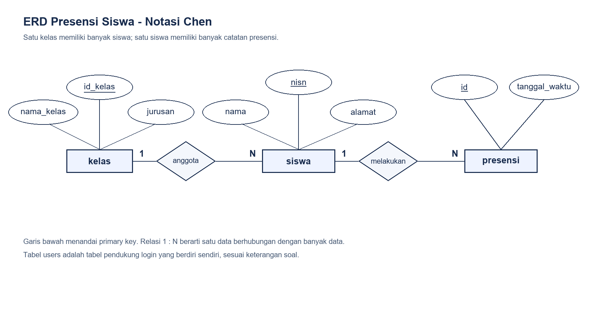
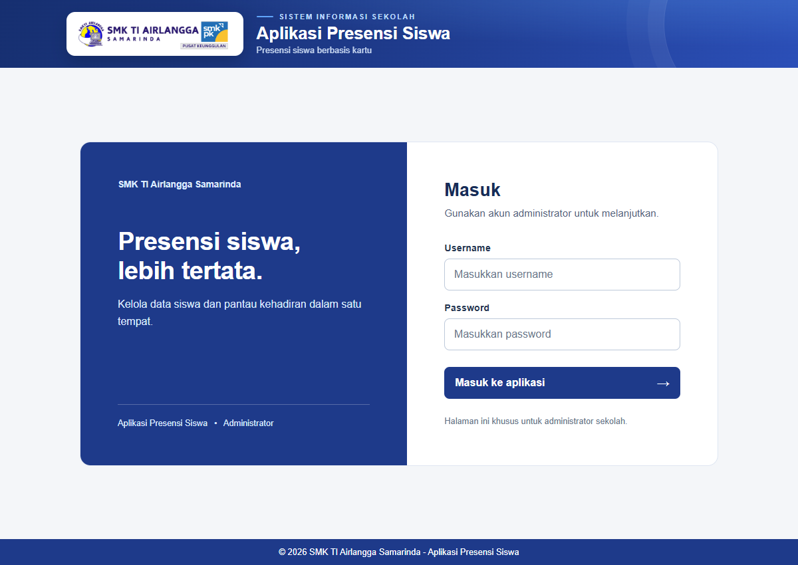
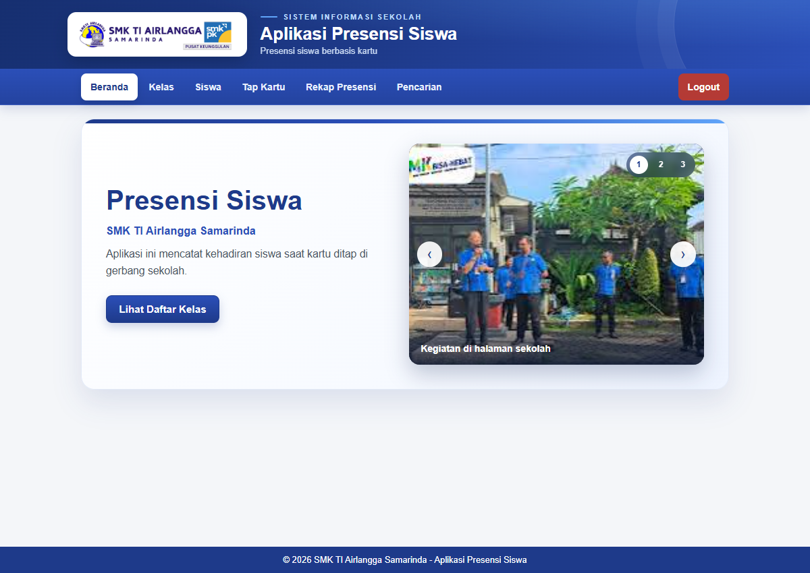
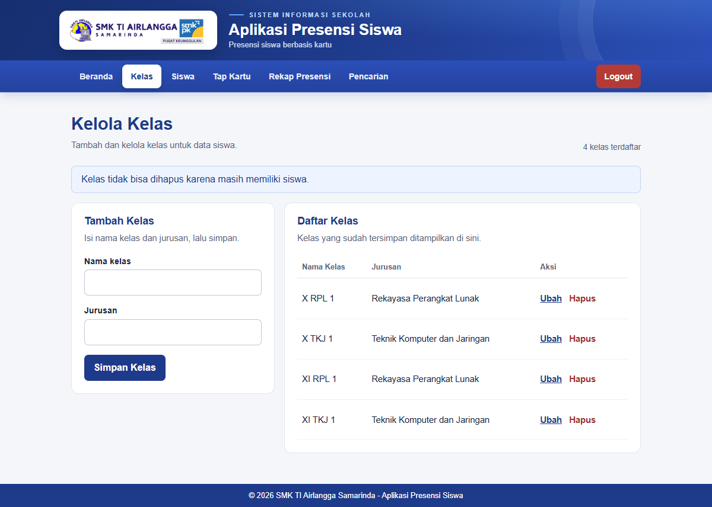
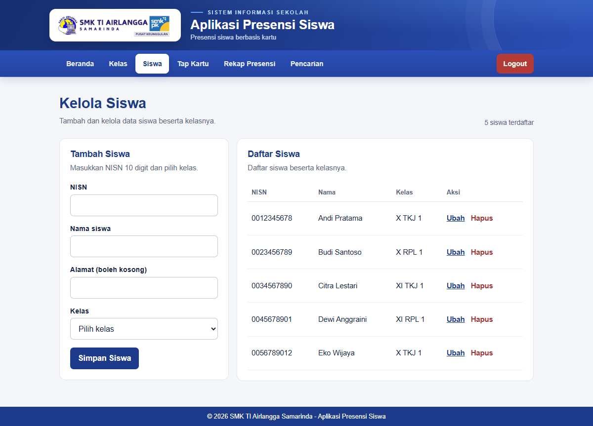
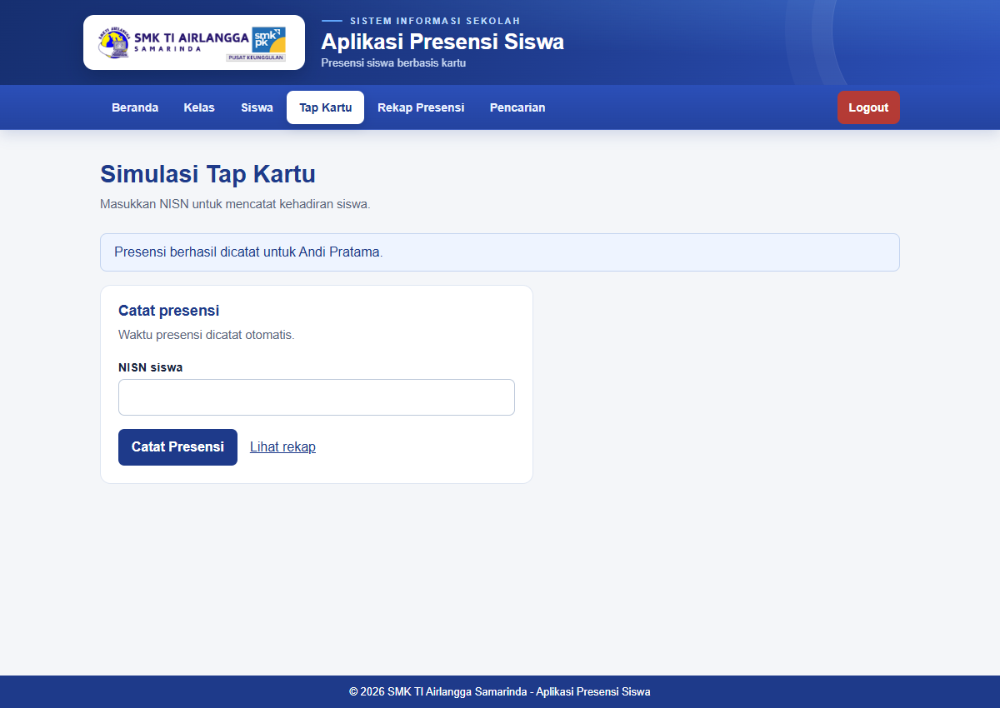
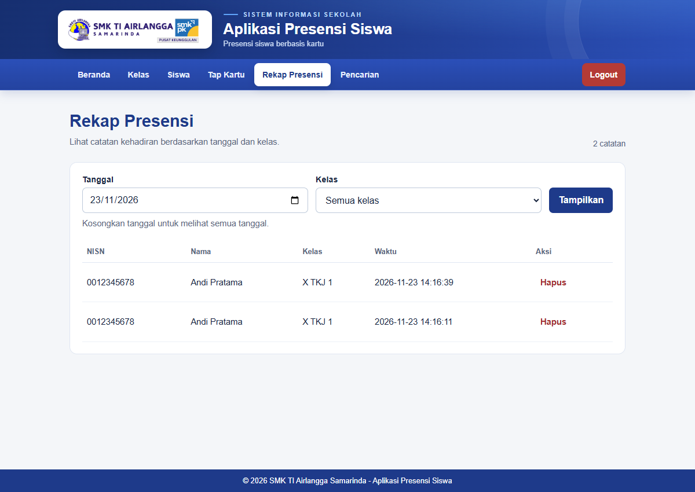
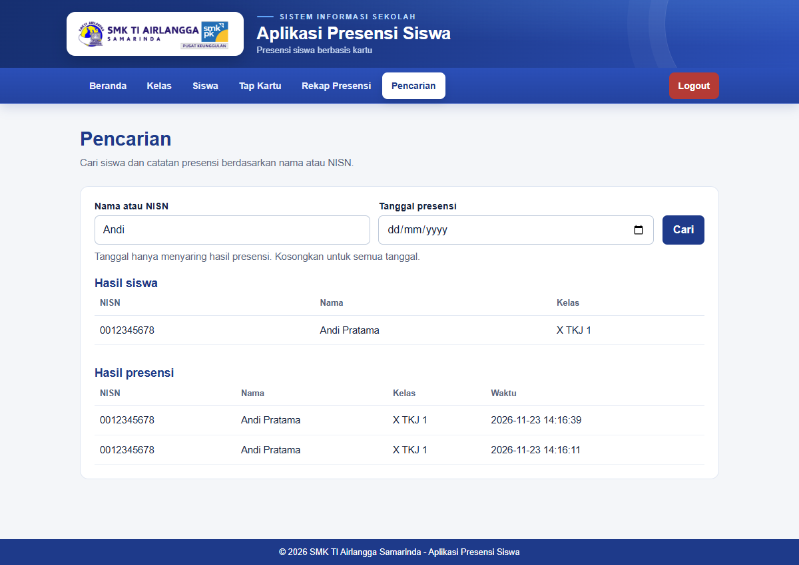
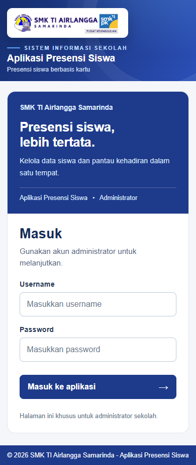
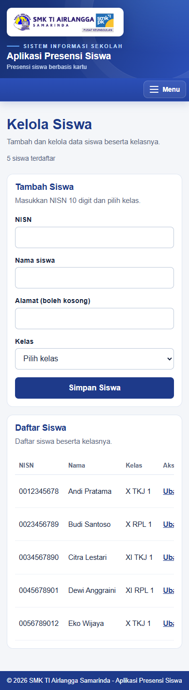

# Aplikasi Presensi Siswa

Aplikasi web untuk administrator mengelola kelas, siswa, dan presensi dengan simulasi tap NISN. Dibuat menggunakan PHP native, PDO, MariaDB/MySQL, HTML, dan CSS.

## Fitur

- Login dan logout administrator dengan session.
- Tambah, lihat, ubah, dan hapus kelas serta siswa.
- Simulasi tap menggunakan NISN dan pencatatan waktu otomatis.
- Rekap presensi dengan filter tanggal dan kelas; catatan presensi dapat dihapus.
- Pencarian siswa dan presensi berdasarkan nama atau NISN.

## Cara menjalankan

1. Salin folder proyek ke `C:\laragon\www\uuk-website` dan jalankan Apache serta MySQL di Laragon.
2. Untuk database baru, jalankan `config/schema.sql` di phpMyAdmin. Jika database sudah berisi data, periksa terlebih dahulu dan jangan menjalankan ulang pembuatan tabel secara sembarangan.
3. Salin `config/config.example.php` menjadi `config/config.php`, lalu sesuaikan alamat, nama database, username, dan password MySQL. File konfigurasi lokal tidak diikutkan ke Git.
4. Untuk instalasi latihan baru, jalankan `php config/seeder.php` dari folder proyek. Seeder menambahkan akun demo dan data contoh; jangan menjalankannya jika data contoh tidak diperlukan.
5. Buka `http://localhost/uuk-website/` dan masuk dengan akun administrator.

## Akun demo

Seeder pada instalasi latihan menyediakan username `admin` dan password `admin123`. Akun ini hanya untuk percobaan lokal dan perlu diganti sebelum digunakan pada sistem yang diakses orang lain. Akun administrator yang sudah ada pada database sendiri dapat berbeda.

## Struktur proyek

- `classes/`: class pengguna, kelas, siswa, dan presensi.
- `config/`: koneksi PDO, pemeriksaan login, skema SQL, dan seeder.
- `layouts/`: header, navigasi, dan footer bersama.
- `assets/`: gambar dan CSS.
- File PHP di folder utama: halaman yang dibuka melalui browser.
- `docs/`: ERD dan tangkapan layar pengujian.

## ERD

Satu kelas memiliki banyak siswa, dan satu siswa dapat memiliki banyak catatan presensi. Tabel `users` menyimpan akun administrator dan tidak terhubung ke tabel lain.

## Hasil pengujian

Pengujian berikut dilakukan pada 23 November 2026 di browser Chrome menggunakan salinan aplikasi dan database latihan terpisah. Hasil ini bukan rekaman data pengguna yang sebenarnya.

| No. | Skenario | Hasil |
| --- | --- | --- |
| 1 | Login dengan password salah | Berhasil: ditolak dan pesan kesalahan muncul |
| 2 | Buka halaman tanpa login lewat URL | Berhasil: diarahkan ke login |
| 3 | Tambah siswa dengan NISN 9 digit | Berhasil: ditolak, isian nama tetap ada |
| 4 | Tambah siswa dengan NISN yang sudah ada | Berhasil: ditolak dengan pesan NISN sudah terdaftar |
| 5 | Tap dengan NISN tidak terdaftar | Berhasil: ditolak dengan pesan yang jelas |
| 6 | Tap dengan NISN terdaftar | Berhasil: muncul di rekap hari itu dengan waktu otomatis |
| 7 | Hapus kelas yang masih memiliki siswa | Berhasil: ditolak dengan pesan yang jelas |
| 8 | Cari siswa berdasarkan sebagian nama | Berhasil: siswa yang sesuai ditampilkan |

Tampilan pada lebar layar 390 piksel juga diperiksa untuk login, kelas, siswa, tap, rekap, dan pencarian. Tabel yang lebih lebar dapat digeser di dalam area tabel.

## Tangkapan layar

Gambar menggunakan akun dan data contoh dari database latihan, bukan data sekolah yang sebenarnya.

## halaman login
- 
## halaman dashboard
- 
## halaman kelas
- 
- 
## halaman simulasi tap
- 
## halaman presensi
- 
## halaman pencarian
- 
## halaman di bagian HP
- 
- 
